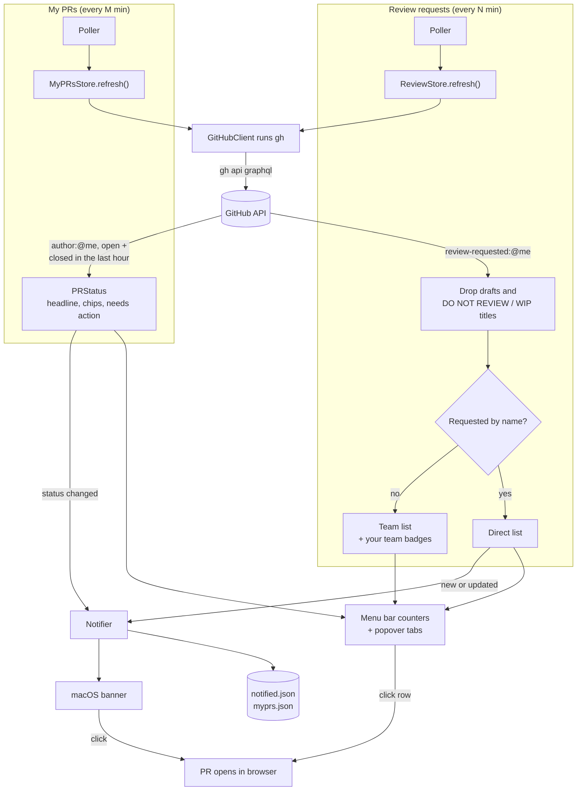

# PR Reviews

A macOS menu bar app that keeps track of pull requests: the ones waiting on
your review, split into a **Direct** tab (you were asked by name) and a **Team**
tab (a team you're on was asked), and your own PRs in a **My PRs** tab with
their current status. You get banners when someone requests you directly and
when one of your PRs changes status.

It uses the GitHub CLI's own login (`gh auth login`). No tokens are stored
anywhere.

## What it does

The menu bar shows the GitHub mark followed by three counters: a person icon
with your direct requests, a two-person icon with your team requests, and an
exclamation mark with how many of your own PRs need you. Click it to open the
list.

- **Direct tab**: PRs matching `user-review-requested:@me`.
- **Team tab**: PRs matching `review-requested:@me` that aren't direct. Each row
  shows which of your teams was asked (e.g. `growth`).
- **My PRs tab**: your open PRs (`author:@me`) as cards, grouped into Needs
  your attention, In merge queue, Waiting on others, Drafts, and Merged & closed
  (merged and closed PRs stay for 1 hour). Each card shows the title, repo and
  PR number, the Linear issue (taken from the `linear.app` link in the PR body,
  click to open it) and the age, then a Review / Checks / Merge grid. Hover the
  checks count to see which checks are failing or running, and click one to
  open its logs. Hover the review cell to see who approved, requested changes,
  commented or is still pending, with their GitHub avatars.
- **Merge queue**: in repos with a merge queue, cards get an **Add to queue**
  button once GitHub says the PR can merge, and **Remove from queue** while it's
  queued. The first click asks to confirm, the second one does it.
- **Needs action** (the third counter) counts PRs with conflicts, failing
  checks, changes requested, a branch behind base, or ready to merge without
  auto-merge on.
- Click a row to open the PR. The footer has refresh, open-on-GitHub, settings
  and quit buttons.
- Drafts and titles matching `DO NOT REVIEW|WIP` are hidden by default in the
  review tabs. My PRs always shows drafts, labelled Draft.
- **Review banners** fire for direct requests only. You get one when a PR is
  newly requested or updated. More than 5 new at once become a single summary
  banner.
- **My PRs banners** fire when one of your PRs is approved, gets changes
  requested, starts failing checks, becomes ready to merge, enters or leaves the
  merge queue, or merges. One banner per PR per change, the most important one.
- On first launch the app records the current state without sending banners,
  so you don't get a flood.
- **Pauses while you're away**: nothing is fetched while the screen is locked,
  the Mac is asleep, the display is off, or another user is active. When you
  come back, both lists refresh right away.
- If `gh` fails (not logged in, network, rate limit), the icon switches to a
  warning triangle, the popover shows the reason, and the last good list stays
  visible. Polling backs off while errors continue.

## How it works

Two independent pollers, each with its own interval, share the same `gh`
client and notifier.



The app never talks to GitHub itself. Every request goes through the `gh` CLI,
so it reuses your existing login and no token is stored.

## Prerequisites

- macOS 14 or later
- Xcode Command Line Tools (`xcode-select --install`). Full Xcode isn't needed.
- [GitHub CLI](https://cli.github.com/), authenticated:
  ```sh
  brew install gh
  gh auth login
  ```

## Install

```sh
cd macos-app
./build.sh
open ~/Applications/"PR Reviews.app"
```

`build.sh` builds a release binary, wraps it in `PR Reviews.app`, signs it
ad-hoc and copies it to `~/Applications` (override with
`PR_REVIEWS_INSTALL_DIR`). It quits a running copy first, so re-run it after
pulling changes.

On first launch, allow notifications when macOS asks. Then open **Settings**
(gear icon) and turn on **Open at login**.

To run the tests for the status logic: `cd macos-app && swift test`.

## Settings

| Setting | Default | Purpose |
| --- | --- | --- |
| Review requests: check every N min | 1 | How often to poll for review requests. |
| Include draft PRs | off | Show drafts in the Direct and Team tabs. |
| Skip titles matching | `DO NOT REVIEW\|WIP` | Case-insensitive regex for the Direct and Team tabs. Empty disables it. |
| My PRs: check every N min | 2 | How often to poll your own PRs. |
| Banners when status changes | on | Banners for your PRs. The tab and counter update either way. |
| gh path | auto | Leave blank to auto-detect (`/opt/homebrew/bin/gh`, `/usr/local/bin/gh`, `~/.asdf/shims/gh`). |
| Open at login | off | Registers the app as a login item. |

## Troubleshooting

- **No banners**: check *System Settings → Notifications → PR Reviews*. Review
  banners only fire for direct requests; team requests just update the counter.
- **A PR shows "Open" or an odd status for a moment**: GitHub computes merge
  state lazily. The app keeps the last known value until GitHub has an answer.
- **Warning triangle in the menu bar**: open the popover to see why. Usually
  `gh auth login` fixes it.
- **`gh` not found**: set its full path in Settings (`which gh` shows it).
- **Open at login fails**: make sure the app runs from `~/Applications` or
  `/Applications`, not from `macos-app/build`.

## Uninstall the app

```sh
pkill -x PRReviews
rm -rf ~/Applications/"PR Reviews.app"
rm -rf ~/Library/Application\ Support/PRReviews
defaults delete io.github.wlepinski-synth.pr-reviews
```

## License

[MIT](LICENSE) © William Lepinski
